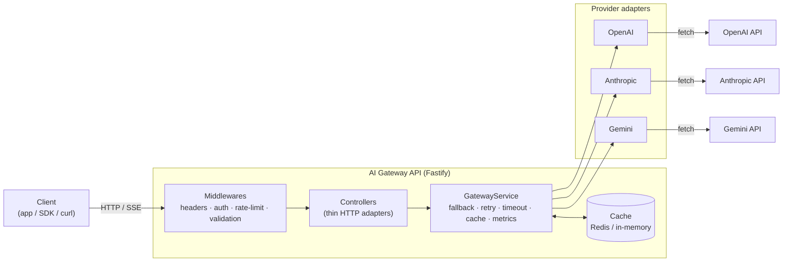

<div align="center">

# 🧠 AI Gateway API

**One API for OpenAI, Google Gemini and Anthropic — with automatic fallback, streaming, token accounting and cost estimation.**

[](https://www.typescriptlang.org/)
[](https://fastify.dev/)
[](https://nodejs.org/)
[](#-testing)
[](#-testing)
[](LICENSE)

**🇧🇷 [Português](README.md) · 🇺🇸 English**

</div>

---

## Overview

Modern products rarely bet on a single AI provider. You want OpenAI's reasoning,
Gemini's price-per-token, Anthropic's long context — and you want to switch
between them without rewriting your application.

**AI Gateway API** puts a single, provider-agnostic HTTP surface in front of all
three. Your app speaks one schema; the gateway handles vendor differences,
**fails over automatically** when a provider is down, **streams** tokens over SSE,
and reports **token usage (real when the provider reports it, estimated otherwise)
and an estimated cost** on every call.

```
                         ┌──────────────────────────────┐
                         │        AI Gateway API         │
  POST /v1/chat  ───────▶│  auth · rate-limit · cache    │
  POST /v1/chat/stream   │  fallback · retry · metrics   │
  POST /v1/embeddings    │                               │
                         │   ┌─────────┬────────┬──────┐ │
                         │   │ OpenAI  │ Gemini │ Anth.│ │──▶ provider APIs
                         │   └─────────┴────────┴──────┘ │
                         └──────────────────────────────┘
```

> **Zero-credential dev mode:** with no API keys set, the gateway serves a
> deterministic **mock provider**, so you can clone, run and explore the whole
> pipeline in seconds — no vendor account required.

---

## ✨ Features

|                                |                                                                                                       |
| ------------------------------ | ----------------------------------------------------------------------------------------------------- |
| 🔀 **Unified API**             | One request schema for chat, streaming and embeddings across three providers.                         |
| 🛟 **Automatic fallback**      | Configurable provider chain; transient 5xx/429 failures roll over to the next. In streaming, failover happens **before the first token** (after that, a mid-stream failure is reported, not silently re-routed). |
| ⚡ **Streaming (SSE)**         | Token-by-token streaming with a normalized `provider` → `delta` → `done`/`error` → `end` event contract. |
| 🔁 **Retry & timeout**         | Bounded exponential backoff with jitter; per-request `AbortController` timeouts; client disconnect cancels upstream. |
| 🧮 **Tokens & cost (estimate)**| Real provider usage when reported, **estimated** otherwise. Cost is an **estimate** from a per-model table; unknown models return `pricingKnown:false` (cost `null`, never a misleading zero). |
| 🗄️ **Response caching**        | Deterministic key, **per-caller isolated** by default (`CACHE_SCOPE`); Redis or in-memory (bounded, LRU). |
| 🔐 **Auth**                    | API-key (constant-time compare) **and** JWT authentication, per-caller identity for attribution.     |
| 🚦 **Rate limiting**           | Fixed-window limiter with standard `X-RateLimit-*` headers, backed by the shared cache.               |
| 📊 **Live dashboard**          | Zero-dependency `/dashboard` with real status, loading/empty/error states and a11y. Protected in production by default. |
| 📖 **OpenAPI**                 | `/openapi.json` always served (with response/error schemas); Swagger UI at `/docs` (on by default outside production). |
| 🧱 **Clean architecture**      | Provider adapters behind an interface, dependency-injected services, typed errors.                    |
| 🐳 **Ops building blocks**     | Multi-stage Docker image (non-root, `tini`, healthcheck), docker-compose with Redis, CI with audit/CodeQL/Dependabot. |

---

## ✅ Production Readiness

An honest read of what is ready and what is not. This project is a **solid technical
demo and extensible base** — it ships many production-grade building blocks, but is
**not a closed, production-ready product**.

| Area | State | Limitation |
| --- | --- | --- |
| Chat (JSON) | **Ready** | — |
| Streaming (SSE) | **Partial** | Failover only **before the first token**; a mid-stream failure becomes `event: error` |
| Embeddings | **Ready** | OpenAI & Gemini; Anthropic has no embeddings |
| Fallback / retry / timeout | **Ready** | Bounded chain; no circuit breaker |
| Redis | **Implemented, optional** | Without Redis, in-memory cache (bounded/LRU) |
| Metrics / dashboard | **In-memory** | Reset on restart; **not** shared across instances; not billing |
| Cost | **Estimate** | Static price table (rev. 2025-01); unknown models → `pricingKnown:false` |
| Persistence (history) | **Absent** | No database; nothing persisted beyond cache/rate-limit in Redis |
| Real providers | **Require credentials** | Without keys, the **mock** is used (blocked in production unless `ALLOW_MOCK_PROVIDER=true`) |
| Mock provider | **Dev/tests** | Deterministic, offline; refuses to run silently in production |
| Vision / multimodal | **Absent (roadmap)** | Message content is text; the `vision` capability is not advertised |

---

## 🧰 Tech Stack

**TypeScript** · **Node.js 20+** · **Fastify 5** · **Zod** · **ioredis** · **pino** ·
**@fastify/swagger** · **JWT** · **Vitest** · **tsup**

No vendor SDKs: adapters talk to the providers' HTTP APIs directly through the
native `fetch`, keeping the dependency tree small and the streaming path fully
under our control.

---

## 🏗️ Architecture



> 📐 Detailed diagrams (request lifecycle, fallback, auth) live in
> **[docs/ARCHITECTURE.md](docs/ARCHITECTURE.md)**.

### Folder structure

```
src/
├── app.ts                 # Application factory: plugins, DI wiring, routes
├── server.ts              # Process entrypoint + graceful shutdown
├── config/                # Zod-validated environment (fail-fast on boot)
├── providers/             # Provider abstraction — the heart of the gateway
│   ├── types.ts           #   the Provider interface every adapter implements
│   ├── openai/            #   OpenAI adapter
│   ├── gemini/            #   Google Gemini adapter
│   ├── anthropic/         #   Anthropic adapter
│   ├── mock/              #   deterministic no-network adapter (dev/tests)
│   └── registry.ts        #   builds & owns the live provider set
├── services/
│   ├── gateway.service.ts #   orchestration: fallback, retry, cache, metrics
│   ├── pricing.ts         #   per-model price table + cost estimator
│   ├── tokens.service.ts  #   token estimation
│   └── metrics.service.ts #   in-process usage aggregation
├── cache/                 # Cache interface + Redis & in-memory implementations
├── middlewares/           # auth · rate-limit · global error handler
├── controllers/           # thin HTTP adapters over the services
├── routes/                # versioned, documented route registration
├── schemas/               # Zod request schemas
├── dashboard/             # self-contained usage dashboard
├── utils/                 # errors, logger, http (retry/timeout), SSE
└── types/                 # provider-agnostic domain model
tests/                     # end-to-end HTTP tests (Fastify inject)
```

**Design principles:** the application depends on a `Provider` _interface_, never
on a vendor SDK — which is exactly what makes providers hot-swappable and the
fallback chain possible. Services receive their dependencies through
constructors (poor-man's DI), so tests inject fakes with zero mocking of modules.

### Request flow

```
request → auth → rate-limit → validate (Zod) → controller
        → GatewayService: cache lookup → build fallback chain
        → try provider (retry + timeout) → on 5xx/429: next provider
        → compute usage + cost → record metrics → cache → respond
```

---

## 🚀 Getting Started

### Prerequisites

- Node.js **≥ 20**
- (optional) Redis, for shared cache / rate limiting across instances
- (optional) Provider API keys — omit them to use the mock provider

### Run locally

```bash
git clone https://github.com/DiegoBrantes/ai-gateway-api.git
cd ai-gateway-api
npm install
cp .env.example .env      # edit if you have provider keys
npm run dev               # http://localhost:3000
```

Open:

- **API docs (Swagger UI):** http://localhost:3000/docs
- **Usage dashboard:** http://localhost:3000/dashboard
- **Health:** http://localhost:3000/health

### Run with Docker (includes Redis)

```bash
docker compose up --build
```

---

## ⚙️ Configuration

All configuration is via environment variables, validated at boot (see
[`.env.example`](.env.example)). Highlights:

| Variable                                                  | Default                 | Description                                        |
| --------------------------------------------------------- | ----------------------- | -------------------------------------------------- |
| `API_KEYS`                                                | `dev-key-please-change` | Comma-separated accepted API keys.                 |
| `DEFAULT_PROVIDER`                                        | `openai`                | Provider used when the caller doesn't specify one. |
| `FALLBACK_PROVIDERS`                                      | `anthropic,gemini`      | Ordered fallback chain.                            |
| `OPENAI_API_KEY` / `ANTHROPIC_API_KEY` / `GEMINI_API_KEY` | —                       | Enable real providers.                             |
| `ALLOW_MOCK_PROVIDER`                                     | _(empty)_               | In production, must be `true` to allow the mock.   |
| `REDIS_URL`                                               | _(empty)_               | Set to use Redis; empty = in-memory cache.         |
| `CACHE_SCOPE`                                             | `principal`             | `principal` (per-caller) or `global`.              |
| `MEMORY_CACHE_MAX_ENTRIES`                                | `10000`                 | In-memory cache cap (LRU).                          |
| `DASHBOARD_PUBLIC`                                        | dev `true` / prod `false` | Expose dashboard/metrics without auth.           |
| `ENABLE_SWAGGER_UI`                                       | dev `true` / prod `false` | Mount Swagger UI (`/openapi.json` always served).|
| `RATE_LIMIT_MAX` / `RATE_LIMIT_WINDOW_MS`                 | `60` / `60000`          | Requests per window per caller.                    |
| `REQUEST_TIMEOUT_MS`                                      | `30000`                 | Per-provider request timeout.                      |
| `PROVIDER_MAX_RETRIES`                                    | `2`                     | Retries before failing over.                       |

---

## 📡 Endpoints

| Method | Path               | Auth | Description                                  |
| ------ | ------------------ | :--: | -------------------------------------------- |
| `POST` | `/v1/chat`         |  ✅  | Chat completion.                             |
| `POST` | `/v1/chat/stream`  |  ✅  | Streaming chat completion (SSE).             |
| `POST` | `/v1/embeddings`   |  ✅  | Create embeddings.                           |
| `POST` | `/auth/token`      |  —   | Exchange an API key for a short-lived JWT.   |
| `GET`  | `/v1/providers`    |  ✅  | Providers, status and `mock` flag.           |
| `GET`  | `/v1/models`       |  ✅  | Models and **per-model capabilities**.       |
| `GET`  | `/v1/usage`        |  ✅  | Usage & cost for the calling key.            |
| `GET`  | `/health`          |  —   | Liveness probe.                              |
| `GET`  | `/ready`           |  —   | Readiness (providers + cache).               |
| `GET`  | `/metrics/summary` | 🔒¹  | Global usage summary (powers the dashboard). |
| `GET`  | `/dashboard`       | 🔒¹  | Live usage dashboard (HTML).                 |
| `GET`  | `/openapi.json`    |  —   | OpenAPI document (always served).            |
| `GET`  | `/docs`            |  —   | Swagger UI (on by default outside prod).     |

> ¹ `/metrics/summary` and `/dashboard` are **public in dev/test** and **protected in
> production** by default (`DASHBOARD_PUBLIC`): they then require `x-api-key`,
> `ADMIN_API_KEY` or a valid JWT.

---

## 💻 Usage Examples

### cURL

```bash
curl -X POST http://localhost:3000/v1/chat \
  -H "content-type: application/json" \
  -H "x-api-key: dev-key-please-change" \
  -d '{
    "provider": "openai",
    "messages": [{ "role": "user", "content": "Explain what a reverse proxy is in one sentence." }]
  }'
```

```jsonc
{
  "id": "b1e6…",
  "provider": "openai",
  "model": "gpt-4o-mini",
  "content": "A reverse proxy is a server that sits in front of backend services…",
  "usage": { "promptTokens": 18, "completionTokens": 24, "totalTokens": 42 },
  "cost": {
    "currency": "USD",
    "promptCost": 0.0000027,
    "completionCost": 0.0000144,
    "totalCost": 0.0000171,
  },
  "attempts": ["openai"],
  "latencyMs": 512,
}
```

### JavaScript (fetch)

```js
const res = await fetch('http://localhost:3000/v1/chat', {
  method: 'POST',
  headers: { 'content-type': 'application/json', 'x-api-key': 'dev-key-please-change' },
  body: JSON.stringify({
    messages: [{ role: 'user', content: 'Give me 3 name ideas for a coffee brand.' }],
  }),
});
const data = await res.json();
console.log(data.content, data.cost.totalCost);
```

### TypeScript (streaming, SSE)

```ts
const res = await fetch('http://localhost:3000/v1/chat/stream', {
  method: 'POST',
  headers: { 'content-type': 'application/json', 'x-api-key': 'dev-key-please-change' },
  body: JSON.stringify({
    messages: [{ role: 'user', content: 'Write a haiku about the sea.' }],
  }),
});

const reader = res.body!.getReader();
const decoder = new TextDecoder();
for (;;) {
  const { value, done } = await reader.read();
  if (done) break;
  process.stdout.write(decoder.decode(value)); // event: delta … event: done …
}
```

---

## 🧪 Testing

```bash
npm test              # run the suite
npm run test:coverage # with coverage report
npm run typecheck     # strict type-check, no emit
```

The suite (**128 tests**, ~95% line / ~80% branch coverage) covers the **real
adapters** (OpenAI/Anthropic/Gemini with mocked `fetch`), the **SSE parser**,
`fetchWithTimeout`, **streaming failover** (before/after the first token), pricing
(incl. `pricingKnown`/micro-dollars), the cache (TTL, **LRU**, **per-caller
isolation**), `RedisCache` (corrupted JSON, health), the **rate limiter**, the
**constant-time** key compare, the **dashboard guard**, the **production/mock**
guards, `/ready`, the **OpenAPI** contract, and the full HTTP surface via Fastify's
`inject` — all with **no network calls**.

---

## 🚢 Deployment

- **Docker:** `docker build -t ai-gateway-api . && docker run -p 3000:3000 --env-file .env ai-gateway-api`
- **Compose:** `docker compose up --build` (gateway + Redis)
- **CI:** every push/PR runs type-check, tests+coverage, build, and a Docker image build via [GitHub Actions](.github/workflows/ci.yml).

The image is multi-stage, runs as a non-root user, and ships a container
`HEALTHCHECK` hitting `/health`.

---

## 🔒 Security

Defaults applied out of the box (details in [SECURITY.md](SECURITY.md)):

- **No default credentials in production** — refuses to boot in
  `NODE_ENV=production` with empty/example `API_KEYS` or a placeholder `JWT_SECRET`.
- **Environment validation** with Zod at boot (fail-fast).
- **Input validation** with Zod on every request.
- **Secret redaction in logs** — `authorization`, `x-api-key`, `cookie` and
  `set-cookie` are masked; prompts and bodies are never logged.
- **Security headers** (`X-Content-Type-Options`, `X-Frame-Options`,
  `Referrer-Policy`, `Permissions-Policy`, HSTS in production).
- **Payload limit** (1 MiB) and per-caller **rate limiting**.
- Aligned with **OWASP API Security Top 10** items.

---

## ⚡ Performance

The gateway is **I/O-bound**, so the design optimizes for latency and resource
safety (details in [docs/PERFORMANCE.md](docs/PERFORMANCE.md)):

- **Fastify** — one of the fastest Node HTTP frameworks.
- **Response cache** — identical requests skip the provider round-trip.
- **Streaming (SSE)** — low time-to-first-token.
- **Bounded retries + timeouts** — a slow provider can't pin a request open.
- **Redis atomic counters** — O(1) rate limiting, correct across instances.

---

## ❓ FAQ

**Do I need API keys to run it?** No — with no credentials the gateway uses a mock
provider, so you can clone, run and test everything in seconds.

**How do I add a fourth provider (e.g. Mistral)?** Create `src/providers/mistral/`
implementing the `Provider` interface, register it in `registry.ts`, add its
pricing. Nothing else changes.

**Does it return 3 answers if all providers are up?** No — it uses **one** provider
at a time; the others are plan B/C, used only if the first fails.

**Why not use the official SDKs?** To control the streaming path and keep
dependencies minimal; each adapter isolates one vendor's shape in a single file.

**Is it production-ready?** As a **base**, it ships production-grade building blocks
(non-root Docker with `tini` + healthcheck, Redis, rate limiting, security headers,
env/boot guards, CI with audit/CodeQL). But it is **not a closed, production-ready
product**: metrics are in-memory (reset on restart, not shared across instances),
there is no history persistence, cost is an **estimate** (not billing), and streaming
failover only applies **before the first token**. See
[Production Readiness](#-production-readiness) for the honest map. For real
production: set real keys, a strong `JWT_SECRET`, `DASHBOARD_PUBLIC=false` and a
shared Redis.

---

## 📚 Documentation

| Document                             | Contents                                     |
| ------------------------------------ | -------------------------------------------- |
| [ARCHITECTURE](docs/ARCHITECTURE.md) | Layers, diagrams (lifecycle, fallback, auth) |
| [DECISIONS](docs/DECISIONS.md)       | Architecture Decision Records (ADRs)         |
| [PERFORMANCE](docs/PERFORMANCE.md)   | Performance choices and how to measure       |
| [SECURITY](SECURITY.md)              | Security policy and design                   |
| [CONTRIBUTING](CONTRIBUTING.md)      | How to contribute                            |
| [CHANGELOG](CHANGELOG.md)            | Version history                              |

---

## 🗺️ Roadmap

- [ ] Additional endpoints: vision, OCR, transcription, translation, image generation, moderation
- [ ] Per-key budget caps and monthly spend limits
- [ ] Persisted metrics (Postgres/ClickHouse) + Prometheus `/metrics`
- [ ] Semantic response cache (embedding-based)
- [ ] Weighted / latency-aware provider routing
- [ ] Official TypeScript client SDK

---

## 🤝 Contributing

Contributions are welcome! Please open an issue to discuss substantial changes
first. For pull requests: keep the type-check and test suite green
(`npm run typecheck && npm test`) and follow the existing architecture — new
providers should implement the `Provider` interface and nothing else needs to change.

---

## 📄 License

[MIT](LICENSE) © Diego de Carvalho Brantes
