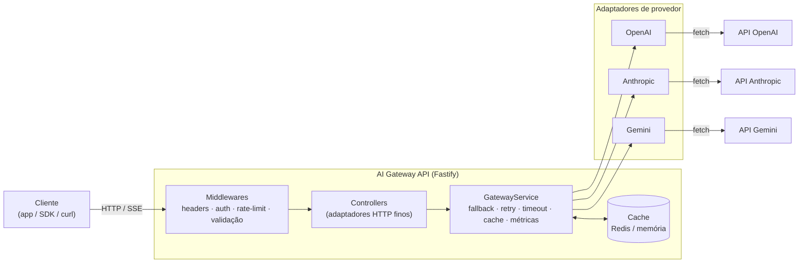
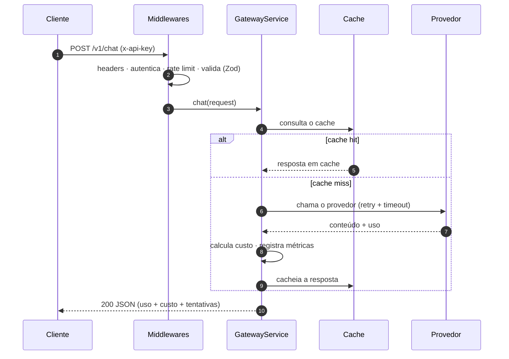

<div align="center">

# 🧠 AI Gateway API

**Uma única API para OpenAI, Google Gemini e Anthropic — com fallback automático, streaming, contagem de tokens e estimativa de custo.**

[](https://github.com/DiegoBrantes/ai-gateway-api/actions/workflows/ci.yml)
[](https://www.typescriptlang.org/)
[](https://fastify.dev/)
[](https://nodejs.org/)
[](#-testes)
[](LICENSE)

**🇧🇷 Português · 🇺🇸 [English](README.en.md)**

</div>

---

## Visão geral

Produtos modernos raramente apostam em um único provedor de IA. Você quer o
raciocínio da OpenAI, o preço por token do Gemini, o contexto longo da Anthropic —
e quer poder trocar entre eles sem reescrever a sua aplicação.

O **AI Gateway API** coloca uma **única porta de entrada HTTP** na frente dos três.
Sua aplicação fala um só formato; o gateway cuida das diferenças de cada provedor,
**troca de provedor automaticamente** quando um cai (fallback), faz **streaming**
de tokens via SSE e informa **o uso exato de tokens e o custo estimado** em cada
chamada.

```
                         ┌──────────────────────────────┐
                         │        AI Gateway API         │
  POST /v1/chat  ───────▶│  auth · rate-limit · cache    │
  POST /v1/chat/stream   │  fallback · retry · métricas  │
  POST /v1/embeddings    │                               │
                         │   ┌─────────┬────────┬──────┐ │
                         │   │ OpenAI  │ Gemini │ Anth.│ │──▶ APIs dos provedores
                         │   └─────────┴────────┴──────┘ │
                         └──────────────────────────────┘
```

> **Modo dev sem credenciais:** sem nenhuma chave de API configurada, o gateway
> usa um **provedor "mock"** (simulado) determinístico. Assim você clona, roda e
> explora todo o fluxo em segundos — sem precisar de conta em nenhum provedor.

---

## ✨ Funcionalidades

|                                   |                                                                                                          |
| --------------------------------- | -------------------------------------------------------------------------------------------------------- |
| 🔀 **API unificada**              | Um único formato de requisição para chat, streaming e embeddings nos três provedores.                    |
| 🛟 **Fallback automático**        | Cadeia de provedores configurável; falhas temporárias (5xx/429) passam para o próximo provedor sozinhas. |
| ⚡ **Streaming (SSE)**            | Streaming token a token, com um contrato de eventos normalizado (`delta` / `done`).                      |
| 🔁 **Retry & timeout**            | Backoff exponencial com jitter e timeout por requisição (via `AbortController`).                         |
| 🧮 **Contagem de tokens & custo** | Usa o consumo real do provedor quando disponível; senão, estima — com preço por uma tabela por modelo.   |
| 🗄️ **Cache de respostas**         | Chave de cache determinística para chamadas de chat idênticas (Redis ou memória).                        |
| 🔐 **Autenticação**               | Autenticação por **API key** e por **JWT**, com identidade por chamador para atribuição de uso.          |
| 🚦 **Rate limiting**              | Limitador por janela fixa, com os cabeçalhos padrão `X-RateLimit-*`, usando o cache compartilhado.       |
| 📊 **Dashboard ao vivo**          | `/dashboard` sem dependências, mostrando o consumo por provedor e por modelo.                            |
| 📖 **OpenAPI + Swagger UI**       | Documentação gerada automaticamente em `/docs`.                                                          |
| 🧱 **Arquitetura limpa**          | Adaptadores de provedor atrás de uma interface, serviços com injeção de dependência, erros tipados.      |
| 🐳 **Pronto para produção**       | Imagem Docker multi-stage, docker-compose com Redis, CI no GitHub Actions.                               |

---

## 🧰 Tecnologias

**TypeScript** · **Node.js 20+** · **Fastify 5** · **Zod** · **ioredis** · **pino** ·
**@fastify/swagger** · **JWT** · **Vitest** · **tsup**

Sem SDKs dos provedores: os adaptadores conversam direto com as APIs HTTP de cada
provedor usando o `fetch` nativo do Node, mantendo a árvore de dependências pequena
e o caminho de streaming totalmente sob controle.

---

## 🏗️ Arquitetura



> 📐 Diagramas detalhados (ciclo de requisição, fallback, autenticação) estão em
> **[docs/ARCHITECTURE.md](docs/ARCHITECTURE.md)**.

### Estrutura de pastas

```
src/
├── app.ts                 # Fábrica da aplicação: plugins, injeção de dependência, rotas
├── server.ts              # Ponto de entrada do processo + encerramento gracioso
├── config/                # Ambiente validado com Zod (falha rápido no boot)
├── providers/             # Abstração de provedores — o coração do gateway
│   ├── types.ts           #   a interface Provider que todo adaptador implementa
│   ├── openai/            #   adaptador da OpenAI
│   ├── gemini/            #   adaptador do Google Gemini
│   ├── anthropic/         #   adaptador da Anthropic
│   ├── mock/              #   adaptador simulado, sem rede (dev/testes)
│   └── registry.ts        #   monta e gerencia o conjunto de provedores ativos
├── services/
│   ├── gateway.service.ts #   orquestração: fallback, retry, cache, métricas
│   ├── pricing.ts         #   tabela de preços por modelo + cálculo de custo
│   ├── tokens.service.ts  #   estimativa de tokens
│   └── metrics.service.ts #   agregação de uso em memória
├── cache/                 # Interface de cache + implementações Redis e em memória
├── middlewares/           # auth · rate-limit · tratamento global de erros
├── controllers/           # adaptadores HTTP finos sobre os serviços
├── routes/                # registro de rotas versionadas e documentadas
├── schemas/               # schemas de validação (Zod)
├── dashboard/             # dashboard de consumo autossuficiente
├── utils/                 # erros, logger, http (retry/timeout), SSE
└── types/                 # modelo de domínio, independente de provedor
tests/                     # testes HTTP de ponta a ponta (inject do Fastify)
```

**Princípio de design:** a aplicação depende de uma **interface `Provider`**, nunca
de um SDK específico — é isso que torna os provedores intercambiáveis e possibilita
a cadeia de fallback. Os serviços recebem suas dependências pelo construtor
(injeção de dependência), então os testes injetam versões falsas sem precisar
"mockar" módulos.

### Ciclo de uma requisição (chat)



---

## 🚀 Começando

### Pré-requisitos

- Node.js **≥ 20**
- (opcional) Redis, para cache / rate limiting compartilhados entre instâncias
- (opcional) Chaves de API dos provedores — sem elas, usa o provedor simulado

### Rodar localmente

```bash
git clone https://github.com/DiegoBrantes/ai-gateway-api.git
cd ai-gateway-api
npm install
cp .env.example .env      # edite se tiver chaves dos provedores
npm run dev               # http://localhost:3000
```

Abra:

- **Documentação da API (Swagger UI):** http://localhost:3000/docs
- **Dashboard de consumo:** http://localhost:3000/dashboard
- **Health (status):** http://localhost:3000/health

### Rodar com Docker (já inclui o Redis)

```bash
docker compose up --build
```

---

## ⚙️ Configuração

Toda a configuração é feita por variáveis de ambiente, validadas no boot (veja o
[`.env.example`](.env.example)). Principais:

| Variável                                                  | Padrão                  | Descrição                                           |
| --------------------------------------------------------- | ----------------------- | --------------------------------------------------- |
| `API_KEYS`                                                | `dev-key-please-change` | Chaves de API aceitas, separadas por vírgula.       |
| `DEFAULT_PROVIDER`                                        | `openai`                | Provedor usado quando o chamador não especifica um. |
| `FALLBACK_PROVIDERS`                                      | `anthropic,gemini`      | Cadeia de fallback, em ordem.                       |
| `OPENAI_API_KEY` / `ANTHROPIC_API_KEY` / `GEMINI_API_KEY` | —                       | Habilitam os provedores reais.                      |
| `REDIS_URL`                                               | _(vazio)_               | Preencha para usar Redis; vazio = cache em memória. |
| `RATE_LIMIT_MAX` / `RATE_LIMIT_WINDOW_MS`                 | `60` / `60000`          | Requisições por janela, por chamador.               |
| `REQUEST_TIMEOUT_MS`                                      | `30000`                 | Timeout por requisição a um provedor.               |
| `PROVIDER_MAX_RETRIES`                                    | `2`                     | Tentativas antes de trocar de provedor.             |

---

## 📡 Endpoints

| Método | Rota               | Auth | Descrição                                       |
| ------ | ------------------ | :--: | ----------------------------------------------- |
| `POST` | `/v1/chat`         |  ✅  | Resposta de chat.                               |
| `POST` | `/v1/chat/stream`  |  ✅  | Resposta de chat em streaming (SSE).            |
| `POST` | `/v1/embeddings`   |  ✅  | Cria embeddings.                                |
| `POST` | `/auth/token`      |  —   | Troca uma API key por um JWT de curta duração.  |
| `GET`  | `/v1/providers`    |  ✅  | Provedores e status de configuração de cada um. |
| `GET`  | `/v1/models`       |  ✅  | Modelos disponíveis e suas capacidades.         |
| `GET`  | `/v1/usage`        |  ✅  | Uso e custo da chave que fez a chamada.         |
| `GET`  | `/health`          |  —   | Verificação de saúde (liveness).                |
| `GET`  | `/metrics/summary` |  —   | Resumo global de uso (alimenta o dashboard).    |
| `GET`  | `/dashboard`       |  —   | Dashboard de consumo ao vivo (HTML).            |
| `GET`  | `/docs`            |  —   | Swagger UI.                                     |

---

## 💻 Exemplos de uso

### cURL

```bash
curl -X POST http://localhost:3000/v1/chat \
  -H "content-type: application/json" \
  -H "x-api-key: dev-key-please-change" \
  -d '{
    "provider": "openai",
    "messages": [{ "role": "user", "content": "Explique o que é um reverse proxy em uma frase." }]
  }'
```

```jsonc
{
  "id": "b1e6…",
  "provider": "openai",
  "model": "gpt-4o-mini",
  "content": "Um reverse proxy é um servidor que fica na frente dos serviços de backend…",
  "usage": { "promptTokens": 18, "completionTokens": 24, "totalTokens": 42 },
  "cost": {
    "currency": "USD",
    "promptCost": 0.0000027,
    "completionCost": 0.0000144,
    "totalCost": 0.0000171,
  },
  "attempts": ["openai"],
  "latencyMs": 512,
}
```

### JavaScript (fetch)

```js
const res = await fetch('http://localhost:3000/v1/chat', {
  method: 'POST',
  headers: { 'content-type': 'application/json', 'x-api-key': 'dev-key-please-change' },
  body: JSON.stringify({
    messages: [
      { role: 'user', content: 'Me dê 3 ideias de nome para uma marca de café.' },
    ],
  }),
});
const data = await res.json();
console.log(data.content, data.cost.totalCost);
```

### TypeScript (streaming, SSE)

```ts
const res = await fetch('http://localhost:3000/v1/chat/stream', {
  method: 'POST',
  headers: { 'content-type': 'application/json', 'x-api-key': 'dev-key-please-change' },
  body: JSON.stringify({
    messages: [{ role: 'user', content: 'Escreva um haikai sobre o mar.' }],
  }),
});

const reader = res.body!.getReader();
const decoder = new TextDecoder();
for (;;) {
  const { value, done } = await reader.read();
  if (done) break;
  process.stdout.write(decoder.decode(value)); // event: delta … event: done …
}
```

---

## 🧪 Testes

```bash
npm test              # roda a suíte
npm run test:coverage # com relatório de cobertura
npm run typecheck     # checagem de tipos estrita, sem gerar arquivos
```

A suíte (35 testes) cobre o cálculo de custo, o cache (incluindo expiração por TTL),
o **fallback / retry / cache / métricas** do gateway, o **rate limiter**, a lógica de
**retry**, o **guard de segredos de produção**, os **security headers** e toda a
superfície HTTP via o `inject` do Fastify — tudo **sem nenhuma chamada de rede**,
graças ao provedor simulado.

---

## 🚢 Deploy

- **Docker:** `docker build -t ai-gateway-api . && docker run -p 3000:3000 --env-file .env ai-gateway-api`
- **Compose:** `docker compose up --build` (gateway + Redis)
- **CI:** cada push/PR roda checagem de tipos, testes com cobertura, build e o build da imagem Docker via [GitHub Actions](.github/workflows/ci.yml).

A imagem é multi-stage, roda como usuário não-root e inclui um `HEALTHCHECK` de
container apontando para o `/health`.

---

## 🔒 Segurança

Boas práticas aplicadas por padrão (detalhes em [SECURITY.md](SECURITY.md)):

- **Sem credenciais padrão em produção** — o serviço se recusa a subir com
  `NODE_ENV=production` se `API_KEYS` estiver vazio/for a chave de exemplo, ou se
  `JWT_SECRET` ainda for o placeholder.
- **Validação de ambiente** com Zod no boot (falha rápido).
- **Validação de entrada** com Zod em toda requisição.
- **Segredos ocultos nos logs** — `authorization`, `x-api-key`, `cookie` e
  `set-cookie` são mascarados; prompts e corpos nunca são logados.
- **Security headers** (`X-Content-Type-Options`, `X-Frame-Options`,
  `Referrer-Policy`, `Permissions-Policy`, HSTS em produção).
- **Limite de payload** (1 MiB) e **rate limiting** por chamador.
- Alinhado a itens do **OWASP API Security Top 10**.

---

## ⚡ Performance

O gateway é **I/O-bound** (o tempo é gasto esperando os provedores), então o design
foca em latência e segurança de recursos (detalhes em
[docs/PERFORMANCE.md](docs/PERFORMANCE.md)):

- **Fastify** — um dos frameworks HTTP mais rápidos do Node.
- **Cache** — requisições idênticas pulam totalmente a chamada ao provedor.
- **Streaming (SSE)** — baixo tempo até o primeiro token.
- **Retry + timeout limitados** — um provedor lento nunca prende uma requisição.
- **Contadores atômicos no Redis** — rate limiting O(1) e correto entre instâncias.

---

## ❓ FAQ

**Preciso de chaves de API para rodar?**
Não. Sem credenciais, o gateway usa um provedor simulado — dá pra clonar, rodar e
testar tudo em segundos.

**Como adiciono um quarto provedor (ex.: Mistral)?**
Crie `src/providers/mistral/` implementando a interface `Provider`, registre em
`registry.ts` e adicione os preços na tabela. Nenhum outro arquivo muda.

**Ele dá 3 respostas se os 3 provedores estiverem no ar?**
Não. Ele usa **um** provedor por vez. Os outros são plano B/C, acionados só se o
primeiro falhar.

**Por que não usar os SDKs oficiais?**
Para controlar o streaming e manter as dependências mínimas. Cada adaptador isola
a diferença de formato de um provedor em um único arquivo.

**Dá pra usar em produção?**
Sim — com Docker, Redis, rate limiting, security headers, validação de ambiente e
CI. Configure suas chaves reais e um `JWT_SECRET` forte.

---

## 📚 Documentação

| Documento                            | Conteúdo                                   |
| ------------------------------------ | ------------------------------------------ |
| [ARCHITECTURE](docs/ARCHITECTURE.md) | Camadas, diagramas (ciclo, fallback, auth) |
| [DECISIONS](docs/DECISIONS.md)       | Registros de decisão arquitetural (ADRs)   |
| [PERFORMANCE](docs/PERFORMANCE.md)   | Escolhas de performance e como medir       |
| [SECURITY](SECURITY.md)              | Política e design de segurança             |
| [CONTRIBUTING](CONTRIBUTING.md)      | Como contribuir                            |
| [CHANGELOG](CHANGELOG.md)            | Histórico de versões                       |

---

## 🗺️ Roadmap

- [ ] Endpoints adicionais: visão, OCR, transcrição, tradução, geração de imagem, moderação
- [ ] Limites de orçamento por chave e teto de gasto mensal
- [ ] Métricas persistidas (Postgres/ClickHouse) + `/metrics` no formato Prometheus
- [ ] Cache semântico de respostas (baseado em embeddings)
- [ ] Roteamento de provedor por peso / por latência
- [ ] SDK cliente oficial em TypeScript

---

## 🤝 Contribuindo

Contribuições são bem-vindas! Para mudanças grandes, abra uma _issue_ antes para
discutir. Nos _pull requests_: mantenha a checagem de tipos e os testes passando
(`npm run typecheck && npm test`) e siga a arquitetura existente — um provedor novo
deve implementar a interface `Provider`, e nada mais precisa mudar.

---

## 📄 Licença

[MIT](LICENSE) © Diego de Carvalho Brantes
