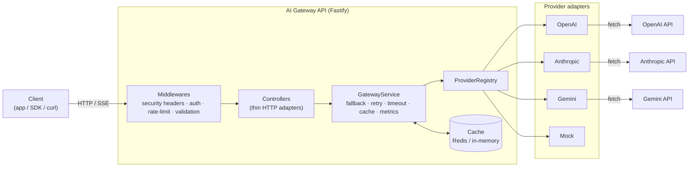
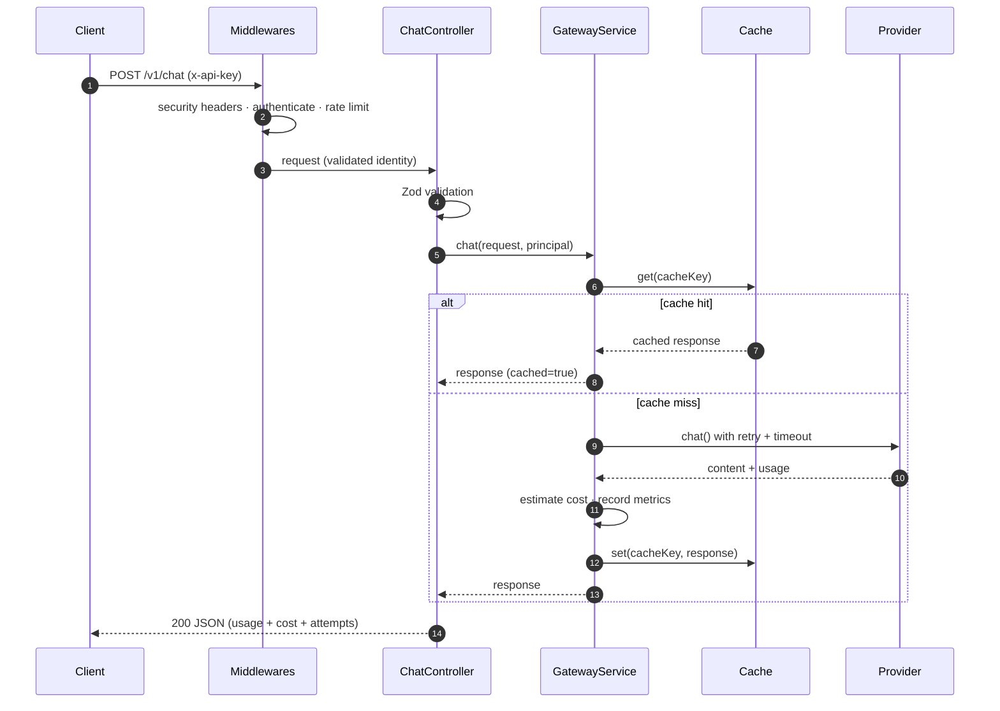
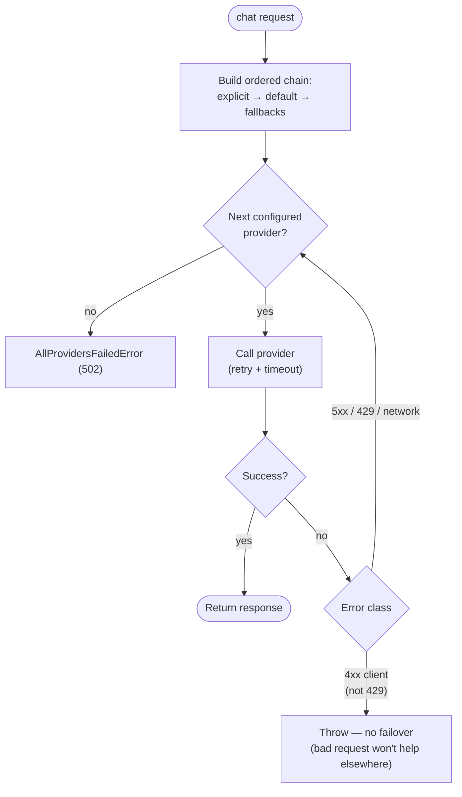
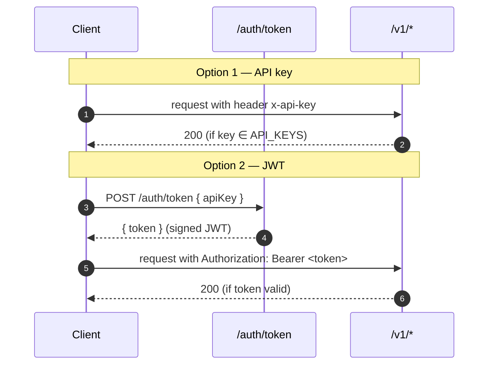

# Architecture

This document explains how **AI Gateway API** is structured and why. It
complements the code, which is organized around a single idea: **the application
depends on a `Provider` interface, never on a vendor SDK.**

## High-level overview

**Layers, from the outside in:**

| Layer            | Responsibility                                                     | Depends on         |
| ---------------- | ------------------------------------------------------------------ | ------------------ |
| Middlewares      | Cross-cutting concerns (auth, rate limit, headers, error handling) | config, cache      |
| Controllers      | Validate input, call a service, serialize output                   | services, schemas  |
| GatewayService   | Orchestration: chain, retry, timeout, cache, metrics, cost         | registry, cache    |
| ProviderRegistry | Owns the set of live providers, answers "who handles X"            | providers          |
| Provider adapter | Map the vendor's HTTP shape to the domain model                    | (nothing internal) |

The dependency arrows only ever point **inward**, which is the essence of Clean
Architecture: inner layers never import outer ones.

## Request lifecycle (chat)

## Fallback & retry logic

Only transient failures (5xx, 429, network/timeout) trigger failover; client
errors surface immediately, because retrying a malformed request on another
provider would just waste time and money.

## Authentication

The resolved identity (`key:…` or `jwt:sub`) is attached to the request and used
for both rate limiting and per-caller usage attribution.

## Key design decisions

- **No vendor SDKs.** Adapters call provider HTTP APIs via the native `fetch`.
  This keeps dependencies minimal and gives full control over the streaming path.
- **Dependency injection via constructors.** Services receive their
  collaborators, so tests inject fakes without module mocking.
- **Cache behind an interface.** Redis for multi-instance deployments; in-memory
  otherwise — the calling code is identical.
- **Fail-fast configuration.** The environment is validated (and production
  secrets are enforced) at boot, never at request time.
- **Mock provider.** Guarantees the whole pipeline is runnable and testable with
  zero credentials and zero network.

See [DECISIONS](DECISIONS.md) for the rationale behind individual trade-offs.
